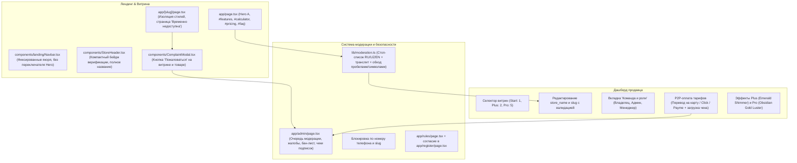

# Комплексный план: Модерация, Мульти-витрины, P2P-Оплата тарифов, URM и фиксы витрины

> **Цель:** Реализовать модерацию витрин, систему P2P-оплаты подписок (Click/Payme/Карта без юрлица), мульти-витринность по тарифам, управление ролями (URM), устранить утечку CSS-переменных витрины на лендинг, зафиксировать Hero A, настроить якорные ссылки в шапке и убрать обрезку названия магазина.

---

## 1. Архитектура и ключевые модули

---

## 2. Детальный список изменений по компонентам

### Блок A. Устранение утечки цветов (Theme Bleeding) и навигация лендинга

1. **Изоляция и сброс CSS-переменных (`components/StorefrontClient.tsx` & `app/page.tsx`)**:
   - **Проблема:** При посещении `/[slug]` компонент `StorefrontClient` записывал инлайн-переменные (`--accent`, `--accent-soft`, `--store-accent`) напрямую в `document.documentElement`, но при переходе по ссылке обратно на `/` (SPA-навигация Next.js) не сбрасывал их. Из-за этого лендинг перекрашивался в цвет витрины.
   - **Решение:**
     - В `components/StorefrontClient.tsx` добавить `cleanup`-функцию в `useEffect`, вызывающую `root.style.removeProperty` для всех переопределенных токенов при размонтировании.
     - В `app/page.tsx` при монтировании принудительно очищать инлайн-стили токенов `document.documentElement`, гарантируя чистую платформенную палитру BioMart (#1F7A5A, #F7F6F2, #1A1A1A).
2. **Фиксация Hero A и удаление переключателя (`app/page.tsx`, `components/landing/Navbar.tsx`)**:
   - Оставить исключительно `HeroVariantA` как основной Hero.
   - Удалить плашку `Hero A / Hero B` из навбара и код переключения.
3. **Исправление якорных ссылок навбара (`app/page.tsx`)**:
   - Назначить точные `id` секциям лендинга:
     - `id="features"` на секцию возможностей/бенто-сетки (с `scroll-mt-20`);
     - `id="calculator"` на секцию калькулятора выгоды;
     - `id="pricing"` на секцию тарифов;
     - `id="faq"` на секцию частых вопросов.
4. **Обновление вопроса в FAQ (`app/page.tsx`)**:
   - Удалить вопрос «Как работает оплата? Оплата происходит напрямую вам...».
   - Заменить на новый актуальный вопрос:
     - *В:* **«Как защищены покупатели и как работает модерация витрин?»**
     - *О:* **«Все витрины BioMart проходят обязательную проверку модерацией перед публикацией. Мы блокируем контрафакт, спам и сомнительные предложения по стоп-листам и жалобам покупателей. Оплата поступает напрямую вам без скрытых комиссий.»**

---

### Блок B. Демо-витрины и отображение названия магазина

1. **Исправление перекрытия названия магазина в `components/StoreHeader.tsx`**:
   - **Проблема:** Длинная текстовая плашка `подтверждено BioMart` (около 130px) на мобильных экранах (390px) сжимала `h1` названия магазина, из-за чего оно обрезалось в `TASHKE...`.
   - **Решение:**
     - Заменить громоздкую текстовую плашку на элегантную компактную круглую иконку верификации (как в Telegram/Instagram: `✓` со всплывающей подсказкой `title="Проверенный продавец BioMart"`).
     - Дать заголовку `h1` максимальную доступную ширину и перенос слов при необходимости.
     - Для демо-витрины убрать пометку «подтверждено BioMart».
2. **Демо-витрины (`components/landing/ShowcaseSection.tsx` и `app/demo/page.tsx`)**:
   - Обновить карточки в `ShowcaseSection`:
     - **Tashkent Drip**: 18 товаров, Одежда и streetwear, «Худи, оверсайз футболки и кроссовки с примеркой перед оплатой», ссылка на `/tashkent_drip` или `/demo?store=tashkent_drip`.
     - **Volt Gadgets**: 24 товара, Электроника и аксессуары, «Гаджеты, наушники и зарядные станции с гарантией и проверкой при курьере», ссылка на `/demo?store=volt_gadgets`.
     - **Aura Perfume**: 15 товаров, Селективный парфюм, «Оригинальные флаконы и распивы с пробником в подарок к каждому заказу», ссылка на `/demo?store=aura_perfume`.
   - В `app/demo/page.tsx` поддержать выбор витрины через параметр `?store=...` с переключением между ними и сохранением темы.

---

### Блок C. Редактирование витрины (Название и URL-slug)

1. **Поля в Дашборде (`app/dashboard/page.tsx`)**:
   - Добавить в настройки карточку **«Основные данные витрины»**:
     - **Название магазина** (`store_name`, валидация 2–60 символов).
     - **Адрес витрины (ссылка)** (`slug`, например `tashkent_drip`, формирует `biomart.uz/tashkent_drip`).
     - **Описание витрины** (`description`).
   - Автоматическая проверка на допустимые символы (a-z, 0-9, дефис, подчеркивание).
   - Проверка на занятость slug и проверка через фильтр стоп-слов перед сохранением.
   - Синхронизация при изменении slug в хранилище Zustand, куках и API `/api/stores`.

---

### Блок D. Реальная P2P-оплата тарифов (без юрлица и мерчанта)

1. **Механизм для предпринимателей без банковского мерчант-аквайринга**:
   - В Узбекистане до регистрации ООО/ИП стандартный способ оплаты услуг — прямой P2P-перевод на карту администратора (Uzcard/Humo) или через Click/Payme по номеру/номеру карты с отправкой чека.
2. **Модальное окно оплаты тарифа (`components/SubscriptionPaymentModal.tsx`)**:
   - Выбор тарифа: **Plus** (59 000 сум/мес) или **Pro** (129 000 сум/мес).
   - Реквизиты для оплаты:
     - Номер карты Uzcard/Humo с кнопкой «Скопировать».
     - Имя получателя перевода.
     - Ссылка/QR-код для быстрой оплаты через Click или Payme.
   - Загрузка квитанции/скриншота чека (через `/api/upload` или ввод номера транзакции/Telegram).
   - При отправке:
     - Заявка сохраняется в список платежей (`subscription_payments`) со статусом `pending`.
     - Продавцу сразу выдается **24-часовой мгновенный доступ** (Grace Period), чтобы не ждать подтверждения.
     - Администратор в `/admin` видит чек и одной кнопкой подтверждает активацию на 30 дней.

---

### Блок E. Полноценная модерация витрин BioMart

1. **Стоп-лист и нормализация (`lib/moderation.ts`)**:
   - База стоп-слов на 3 языках (RU, UZ, EN):
     - Запрещенные товары (оружие, наркотические вещества, табак/вейпы, нелегальные медикаменты, реплики с мошенническим введением в заблуждение).
     - Ненормативная лексика и мат (русский, узбекский, английский).
     - Фишинг и мошенничество.
   - **Защита от обхода (Anti-Bypass)**:
     - Нормализация транслита и омоглифов (замена кириллических «а, с, е, о, р, х» на латинские и наоборот).
     - Снятие разделителей (пробелы, точки, дефисы: `х у д и`, `s.p.a.m`).
     - Замена спецсимволов и цифр (`0` -> `o`, `@` -> `a`, `$` -> `s`, `1` -> `i`).
     - Схлопывание дублирующихся букв.
   - Метод `validateStoreContent({ name, slug, description, products })` возвращает понятную ошибку: *«Текст содержит недопустимые слова: "[слово]". Исправьте его для публикации витрины.»*
2. **Статусы витрин (`pending`, `published`, `rejected`, `needs_changes`)**:
   - Новые созданные витрины получают статус `pending`.
   - Если статус `rejected`: покупатель видит экран **«Витрина временно недоступна»** (магазин на проверке или временно отключен).
   - Если статус `needs_changes`: продавцу в дашборде выводится желтый баннер с комментарием модератора: *«Модератор запросил изменения: [комментарий]»*.
3. **Панель модерации администратора (`app/admin/page.tsx`)**:
   - Доступ по паролю администратора (с сохранением сессии в `admin_session`).
   - Раздел **«Очередь модерации»**:
     - Список витрин со статусами, датой и товарами.
     - Кнопки: «Одобрить» (переводит в `published`), «Вернуть на правку» (модалка для ввода комментария), «Заблокировать» (переводит в `rejected`).
   - Раздел **«Жалобы покупателей»**:
     - Список входящих жалоб с указанием причины, контакта заявителя и ссылки на магазин/товар.
     - Действия: «Заблокировать витрину», «Отклонить жалобу».
   - Раздел **«Черный список»**:
     - Блокировка номеров телефонов и slug'ов.
     - При попытке регистрации/создания с заблокированным номером или ником система выдает ошибку.
   - Раздел **«Оплаты подписок»**:
     - Просмотр прикрепленных чеков Click/Payme и кнопка подтверждения.
4. **Кнопка «Пожаловаться» (`components/ComplaintModal.tsx`)**:
   - Размещается в шапке витрины (рядом с контактами) и в карточке товара.
   - Причины: Мат / Оскорбления, Мошенничество, Запрещенный товар, Спам, Другое.
   - Сохранение в `/api/complaints` и отображение в панели админа.
5. **Правила платформы и согласие при регистрации**:
   - Страница `app/rules/page.tsx` с четкими правилами модерации и списком запрещенных к продаже товаров в Узбекистане.
   - В форме регистрации `app/register/page.tsx`: обязательный чекбокс согласия: *«Я принимаю Правила платформы и Пользовательское соглашение»*.

---

### Блок F. Мульти-витринность по тарифам

1. **Лимиты витрин (`lib/constants.ts`)**:
   - `PLAN_LIMITS.start.maxStores = 1`
   - `PLAN_LIMITS.plus.maxStores = 2`
   - `PLAN_LIMITS.pro.maxStores = 5`
2. **Селектор витрин в шапке Дашборда (`components/dashboard/StoreSwitcher.tsx`)**:
   - Отображает текущую активную витрину (`activeSlug`).
   - Дропдаун со списком всех витрин пользователя с быстрым переключением между ними за 1 клик.
   - Кнопка **«+ Создать витрину»**:
     - Если лимит тарифа исчерпан: показывает модалку перехода на тариф Plus/Pro.
     - Если лимит позволяет: открывает окно создания второй витрины.

---

### Блок G. Управление ролями сотрудников (URM: User Role Management)

1. **Вкладка «Команда и роли» в Дашборде (`app/dashboard/page.tsx`)**:
   - Роли:
     - **Владелец (Owner)**: полный доступ (удаление магазина, смена тарифа, платежи, сотрудники).
     - **Администратор (Admin)**: каталог товаров, категории, дизайн, промокоды, обработка заказов.
     - **Менеджер (Manager)**: только просмотр и обработка заказов, просмотр наличия (нет доступа к финансовым настройкам, смене тарифа и удалению магазина).
   - Список текущих сотрудников, кнопка добавления по телефону/Telegram и выбор роли.

---

### Блок H. Премиальные визуальные эффекты тарифов Plus и Pro

1. **Тариф Plus**:
   - Элегантная акцентная граница с изумрудным градиентным свечением.
   - Бейдж `Активен` с мягким пульсирующим ореолом `emerald halo`.
2. **Тариф Pro (VIP Business)**:
   - Обсидианово-золотой люксовый стиль (глубокий темный фон, тонкая золотая окантовка).
   - Анимированный переливающийся шиммер-эффект (`conic-gradient` или золотой блик).
   - Бейдж `👑 Pro Активен` с золотым люксовым переливом.

---

## 3. План тестирования и верификации

1. **Тест утечки темы**:
   - Открыть `http://localhost:3000/tashkent_drip` (витрина).
   - Нажать на логотип BioMart и вернуться на `http://localhost:3000/` (лендинг).
   - Убедиться, что цвет кнопки и плашек на лендинге строго `#1F7A5A` (зеленый BioMart), а не терракотовый/коричневый витрины.
2. **Тест навигации лендинга**:
   - Кликнуть по ссылкам `Возможности`, `Калькулятор`, `Тарифы`, `FAQ` в навбаре.
   - Убедиться, что страница плавно скроллится к соответствующим секциям.
3. **Тест мобильного заголовка магазина**:
   - Открыть `/tashkent_drip` в разрешении 390px.
   - Убедиться, что название магазина `Tashkent Drip` видно целиком, не обрезается и гармонично сочетается с компактным значком верификации.
4. **Тест редактирования витрины**:
   - В дашборде изменить название магазина и slug.
   - Проверить валидацию и сохранение.
5. **Тест модерации и жалоб**:
   - Попробовать сохранить название или товар с недопустимым словом — убедиться, что отображается понятная ошибка.
   - Отправить жалобу через кнопку «Пожаловаться» на витрине — проверить появление в `/admin`.
6. **Тест P2P-оплаты**:
   - Нажать «Оплатить тариф Plus» — проверить модалку с картой и загрузкой чека.
7. **Тест мульти-витрин и URM**:
   - Проверить добавление второй витрины на тарифе Plus/Pro и переключение между ними.
   - Добавить менеджера в разделе «Команда и роли».
8. **Проверка ограничений**:
   - Убедиться, что **НЕ выполнялся `git push`** (`Ne pushay!!!!`).
